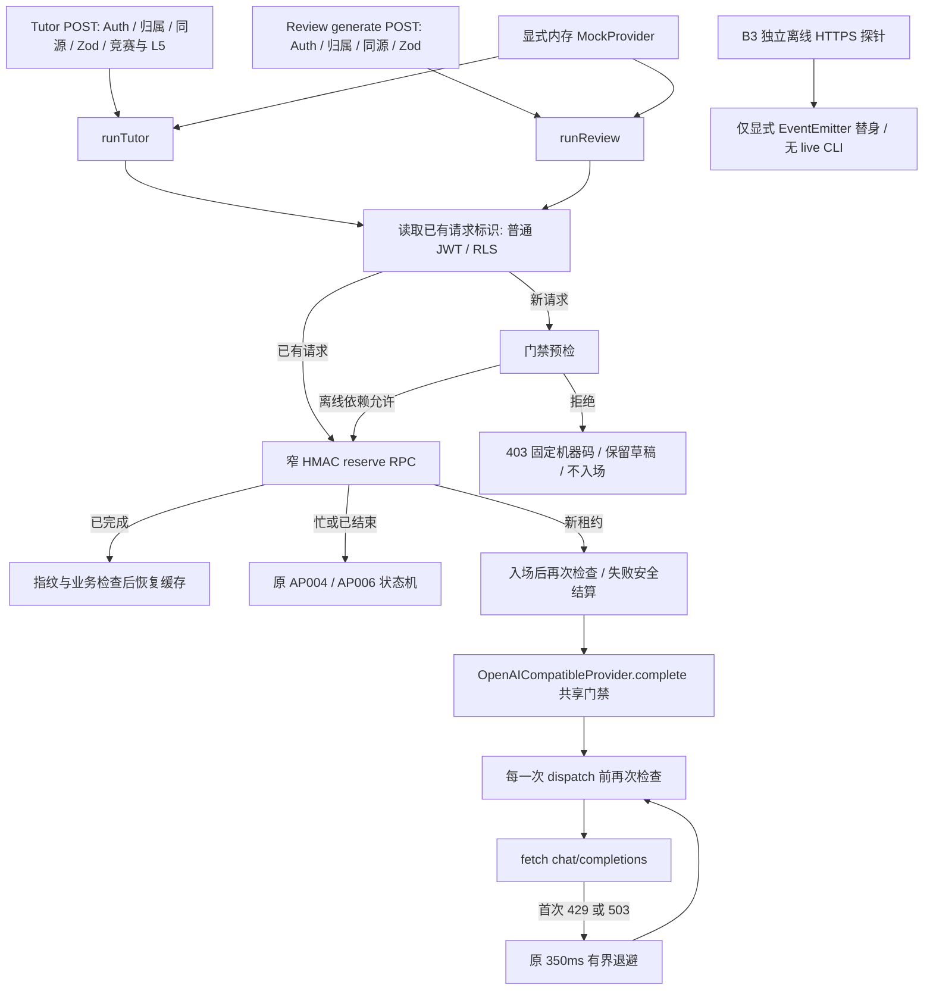

# M3.5.3 免费模型服务端默认拒绝门禁

2026-10-27，Asia/Shanghai。**本地门禁与恢复逻辑 PASS：专项 100/100、全量 461/461、推荐 36/36、桌面/移动 E2E 58/58，最终测试失败 0。退出计数汇总有单独的 collection_failed，见第 7 节，未补零。** 本轮只授权本地实现及离线测试，结束后停止；不执行 B4、真实模型/免费资格探测、真实 Key 读取、生产数据库、011/012 托管迁移、部署或 Git commit/push/PR。

## 1. 实际基线与交接差异

实际起始 HEAD 为 `59b31be2cbd2756de79228a12914b371dc02d2ec`，`git status --porcelain=v1` 为空。它恰好提交了上一轮的 12 文件、463 insertions/13 deletions；父提交是 `a257716`。因此交接“a257716 + 9 修改/3 新增”是历史时点，当前没有待覆盖的旧修改。此前 B3 五文件、011 和历史验收原文保留。

已读两份 M353 离线报告、实际 Provider/配置/Orchestrator/路由/客户端、SQL 权限、既有测试及开发计划。M3.5 真实闭环未完成；B4 没有新授权；历史 A/A2 用量与费用 UNKNOWN。没有把历史 USD 1.10 当作新许可。

## 2. 原调用路径与风险



原来两个 Orchestrator 默认直接构造生产 Provider；`complete()` 仅做输入、超时、输出/usage 限制，并无免费资格/独立执行授权控制。直接构造或以后增加间接调用均可触及 HTTP；仅保护按钮/路由不够。唯一现有生成 HTTP 位于 Provider 的 `/chat/completions`，首次 429/503 最多重试一次，没有模型/Provider fallback。未发现后台生成任务、第二套生成 SDK 或其他产品生成端点。

现在唯一生产构造位置是 `runtime-provider.ts`，共享 Provider 本身仍负责发送边界，所以直接构造默认也拒绝。源路径回归检查约束生产不导入 Fixture、两处 complete 入口与工厂位置。B3 不被 src 导入，不继承生产 Provider，也没有 Key/环境加载或真实 CLI，本轮不改 B3。

## 3. 可信证据来源、局限与设计

仓库没有独立验证 Google 项目、密钥所属范围、实际 billing tier、免费模型资格/配额和“不会转付费”的验证器；已有配置、模型名/Flash 字样、公开价目表、历史成功或超时都不构成该账户的独立证明。[历史报告 §9.5](M353_PROVIDER_EVALUATION.md#95-用量及官方账单能核到什么) 也未取得真实项目账单证据。本轮不联网补证、不读取 Key 或私有页面，当前真实资格保持 UNKNOWN/BLOCKED。

实现分两层：

- **纯策略模型**：接受未来独立验证器的 `verified` 结果契约，校验来源结果结构、免费且 hard-free-only、有效期、精确 provider/baseUrl/model/projectRef/credentialRef 绑定、批准范围，再校验独立执行授权的相同绑定及 user/resource/request/operation、有效期和撤销状态。资格最多 15 分钟，执行授权最多 5 分钟；未来时间/过长/过期均拒绝。这只是保守的离线判定边界，不能证明供应商在窗口内不会改变计费。
- **生产执行策略**：资格源和授权源固定为 unavailable，批准范围为空，未冒造项目/凭据引用。因此没有真实 allow 路径，没有 JSON/文件/环境变量证据导入器，没有 `FREE_TIER=true` 或历史预算开关。纯策略返回 `verified-free` 只用于合成测试，不是可交给 HTTP 的实际许可证。

真实放行仍须后续建立可认证的独立证据源：证明实际项目与实际凭据绑定、该模型请求适用免费范围及硬性不转付费，具备撤销/过期语义；真实执行授权还须当前阶段独立同意、精确请求范围及持久防重/跨实例控制。当前没有安装这样的适配器或授权账本，不能拿自签 JSON、人工布尔、测试 Policy、来源名称字符串或单次成功代替。不得通过生成请求试探免费资格。

| 情况 | 行为/固定错误码 |
| --- | --- |
| 显式 Offline Mock 依赖 | 仅内存 Mock 或隔离测试传输；不选择真实 Provider |
| 未核实 / UNKNOWN / 未知计费模式 | LLM_FREE_TIER_UNVERIFIED |
| 配置缺失/损坏 | LLM_GATE_CONFIG_INVALID；原基础配置缺失仍为 LLM_NOT_CONFIGURED |
| 证据损坏/不符合契约 | LLM_EVIDENCE_INVALID |
| 证据失效/过期/未来/超长 | LLM_EVIDENCE_EXPIRED |
| 项目/凭据/请求目标绑定不符 | LLM_EVIDENCE_SCOPE_MISMATCH |
| Paid Tier / paid fallback | LLM_PAID_TIER_DENIED |
| Provider/模型未批准 | LLM_MODEL_NOT_APPROVED |
| 检查器报错/损坏返回 | LLM_QUALIFICATION_CHECK_FAILED |
| 免费判定成立，但缺当前有效、未撤销且精确绑定的独立授权 | LLM_EXECUTION_UNAUTHORIZED |

拒绝均为独立 403 类别，不包装成模型超时、上游失败或质量审核失败。HTTP 只返回固定 code/message，不返回证据、项目/凭据引用、Key、nonce、usage 或内部推理。门禁不写原始日志；验证器异常原文被丢弃。

## 4. Tutor / Review 与恢复

新请求预检拒绝时，不 reserve、不创建用量/处理记录、不调用 complete/fetch，不执行重试或回退。显式 Mock 不改变原 L0–L5、竞赛/完成、Review 独立授权、输出审核、HMAC/配额/租约。

已有请求只用普通 JWT 查询其标识是否存在，不读私有租约/nonce/usage；再经原 reserve RPC 检查归属、指纹、当前业务状态，原 AP004/AP006/缓存分支保持权威，历史窗口外的已知请求也可恢复。缓存读取不需要新模型许可。若标识检查/入场之间状态变化，或入场后策略转拒绝，try/catch 会以失败及实际 usage 结算，不展示分析。此前有实际发送尝试时保留其 usage/未知费用提醒，不新增虚构的“门禁拒绝 HTTP attempt”。

Review 门禁拒绝后保留追问/笔记/历史，清除当前页未确认票据，不自动重试、不伪报超时或成本为零；真正传输/结算未知的 5xx 仍沿用原编号核对。Tutor 同样保留输入，已知门禁拒绝/已结束票据不继续“查询原请求”。

**012 必要性**：联调发现 Tutor 原同编号分支与旧 Review 一样，即使 lease 已过期仍永久 AP004。普通 JWT 无私有 lease 列权限，应用不能安全判定/修改，故先说明原因后追加 `202610270012_tutor_retry_recovery.sql`，只在现有失败判断加上“pending 且已过期”，返回 AP006。精确片段匹配、未知定义原子拒绝、重放不变、ACL/search_path/HMAC/配额及晚到拒绝均测试；应用迁移不回写用户数据。001–011 不变，011/012 托管均未执行。

客户端票据仍仅在页面内存；未新增私人追问的持久化，不宣称跨标签/崩溃 exactly-once。数据库不可达或 finish 响应未知时仍依赖原编号与租约恢复，不能凭本地成功替代托管 JWT、多连接或跨实例验收。

## 5. 离线 Mock 的隔离

生产工厂不导入 tests，不依据 NODE_ENV、环境布尔或客户端字段开启 Mock。旧协议测试改为显式导入 `tests/fixtures/offline-provider.ts`，原断言全部保留；只注入 fetch 不会绕过生产门禁。

`npm run test:e2e` 调用新隔离脚本：只复制跟踪及明确新增文件到私有临时目录，排除所有 `.env*`，链接已有 node_modules，不安装依赖。子进程环境由常量白名单构建、HOME 为空；用合成 Supabase URL/public key/APP_URL 构建动态页面，避免无配置构建的预渲染空壳。

只有副本的工厂给 `http://127.0.0.1:54002/v1` 注入测试传输；它同时严格检查模型、合成 Key、签名密钥、最终 URL、Authorization 和模型字段，禁止重定向。3103 的合成 HTTPS 配置保留生产拒绝工厂；新 E2E 在此验证 Tutor/Review 拒绝、草稿/历史保护和缓存恢复。源工作区工厂不改写；没有生产假回复开关。

Node 禁外网/DNS/敏感配置文件读取，固定 loopback 由内存 lookup 返回；浏览器有路由白名单、外部解析禁止及后台联网关闭。本轮实际执行另置 macOS deny-network、仅 loopback 的操作系统沙箱。原生浏览器底层尝试次数未系统采集时仍标 UNKNOWN，不伪填零。

## 6. 测试与结果

以下均为本轮真实执行的冻结版本结果，不沿用上一轮 394/394、54/54。正式检查在不含 `.env*` 的受控临时副本执行，最后串行复验没有改原测试预算/断言。

| 实际命令 | 本轮结果 |
| --- | --- |
| `npm run lint` | PASS，exit 0，零警告 |
| `npm run typecheck` | PASS，exit 0 |
| 门禁/路由/恢复/SQL 专项（下方完整命令） | PASS，100/100，6 文件；协议相关首轮 132/132，修正后扩展为 138/138 |
| `npm run test -- --maxWorkers=1` | 最终 PASS，461/461，44 文件，166.44 秒；含 B3 原 90 项、所有旧用例 |
| `npm run test:recommendations -- --maxWorkers=1` | PASS，36/36，8 文件，109.78 秒；未缩短真实时隙/冷却 |
| `npm run build` | PASS，exit 0，含 postbuild Monaco/旧 sanitizer 检查；E2E 合成配置构建另 PASS |
| `npm run test:e2e` | 最新 PASS，58/58，1.4 分钟，exit 0；原 54 项保留，新增 4 项覆盖桌面/移动；retries=0 |
| `git diff --check` / 基线文件保护 | PASS；HEAD 未变，无 staged/删除，B3 五文件、001–011、旧两份验收和推荐引擎不变 |

专项完整命令：

```bash
npm run test -- tests/unit/generation-gate.test.ts tests/unit/generation-gate-api.test.ts tests/unit/generation-paths.test.ts tests/unit/review-workspace.test.tsx tests/integration/review-database.test.ts tests/integration/m2-database.test.ts --maxWorkers=1
```

第一轮类型检查发现测试 Policy 的 Object.freeze 推断把字面量拓宽为 boolean/string，补 `as const` 后 typecheck PASS，相关 138 项通过；没有放宽策略。早期版本全量 458/458、推荐 36/36、构建通过；随后 012 版本并行争用轮为 460 PASS/1 FAIL（原候选池 5000ms 超时）。该失败保留，不提高超时/不删除断言；最终串行 461/461 PASS。B3 90 项继续回归，固定 CF 重放保留真实时隙/冷却，不再次联网取证。

012 的 PGlite 测试验证同编号忙/过期结束、显式新请求、旧 worker 晚到拒绝、重放及 ACL；Review 真实 orchestrator+SQL 验证门禁关闭仍缓存恢复、指纹冲突仍拒绝、拒绝新请求不增加记录、入场后拒绝为 failed/usage=[] 且原分析不变。PGlite Auth 为替身，HTTP E2E 不是真实 Supabase/JWT，也不是模型质量测试。

## 7. 安全与费用审计

| 行为 | 本轮结果与证据边界 |
| --- | --- |
| 真实模型生成 / listModels / countTokens | 0 / 0 / 0；默认拒绝工厂，测试仅内存/固定 loopback，未运行 B4 |
| 真实 API Key 读取 | 0；不读真实配置文件，测试副本排除 `.env*`，子进程不继承凭据，只给合成 Key |
| 付费 API / 付费回退 / 新付费资源 | 0 / 0 / 0 |
| 生产 DB 读取/写入、托管迁移、部署 | 0 / 0 / 0 / 0 |
| 外部 HTTP / DNS 全轮总尝试 | UNKNOWN / UNKNOWN；不能从不完整退出计数或原生浏览器缺失采样推成零 |
| 最新 E2E 受控 Node 外部 HTTP / DNS / 真实凭据读取计数 | 0 / 0 / 0；17 份完整审计，invalid/incomplete=0 |
| 数据外发 | 仅合成夹具流向 loopback Mock；没有向外部模型/服务发送私人材料或项目源码 |
| Git commit / push / PR | 0 / 0 / 0；本轮 HEAD 仍 `59b31be` |

**单独的审计收集失败没有改写成 PASS**：串行六条检查命令全部 exit 0，但临时汇总器退出 1，原因是复用 B3 的 exit-time 审计留下 `25028-0.pending`（143 字节）和 `25007-0.pending`（0 字节），均没有发布 JSON。19 份已发布记录有效，另两份 incomplete，汇总为 collection_failed、counters=NULL。未手工发布残片、删除标记、填零或声称本轮所有运行时已完整计数；未以此增加真实探测。这里只能确认缺失/部分写入，未取得足够进程证据认定其具体终止原因。

最新 E2E 的完整审计独立为 PASS：17 份 Node 记录六计数均 0，12 份浏览器路由记录允许 4556 次 loopback 页面请求、拒绝 0；这个数量不是全部服务器请求计数。操作系统沙箱只开放 loopback，浏览器底层/background HTTP/DNS 计数仍 UNKNOWN，不能拿 Node 采样覆盖原生进程。

门禁可审计性来自固定决策/错误码、共享发送边界、静态路径检查和离线运行证据；未声称已经建立生产独立审计事件账本、真实资格来源或账单核对。历史 A/A2 费用仍 UNKNOWN。

## 8. 四个独立门槛与剩余风险

| 门槛 | 状态 |
| --- | --- |
| 本地拒绝策略、共享边界与恢复 | PASS；功能测试最终 0 FAIL；退出计数汇总单列 collection_failed/UNKNOWN，不宣称完整零审计 |
| 真实项目/凭据/模型免费资格 | BLOCKED：无可信适配器/证据，未联网验证 |
| B4 或其他真实网络生成授权 | NOT_RUN：无新授权，未执行 |
| 生产部署及托管 JWT/RLS/012 | NOT_RUN：未授权/未执行；不能借历史结构或本地 PASS 放行 |

生产真实生成将保持关闭。纯策略的合成成功不能证明免费资格、授权真伪、供应商不转付费、跨实例防重或真实网络可用。未来真实接线要单独审查独立证据与持久授权源，不能直接把测试 Policy 配进生产。

下一项可安全开发：复用原生临时 PostgreSQL 运行器，增加门禁前后 RPC/012 的多连接竞态与未知结算恢复验证；不连接生产、不运行真实模型。需要新授权的部分仍是指定目标托管核验/迁移和可信证据准备后的 B4；本轮结束不自动执行。

## 9. 文件清单与证据

本轮共 33 文件（修改 22，新增 11），无删除；历史报告保持原样。命令及证据见第 10 节。
| 状态 | 文件 | 用途 |
| --- | --- | --- |
| 修改 | `AGENTS.md` | 本轮规则、使用/迁移/进度或完整验收文档；历史记录保留 |
| 修改 | `CODEX_PROMPT.md` | 本轮规则、使用/迁移/进度或完整验收文档；历史记录保留 |
| 修改 | `README.md` | 本轮规则、使用/迁移/进度或完整验收文档；历史记录保留 |
| 修改 | `docs/MILESTONES.md` | 本轮规则、使用/迁移/进度或完整验收文档；历史记录保留 |
| 修改 | `package.json` | test:e2e 指向隔离入口，无新增依赖或锁文件变更 |
| 修改 | `playwright.config.ts` | 本机 3103 保留生产门禁，新测试覆盖桌面/移动 |
| 修改 | `src/components/practice/tutor-conversation.tsx` | 拒绝/已结束保留输入并结束本页旧票据 |
| 修改 | `src/components/reviews/review-workspace.tsx` | 门禁拒绝保留草稿与历史，避免误报超时/新用量 |
| 修改 | `src/server/review/orchestrator.ts` | 独立 Review 同样接入，不改 Prompt/审核 |
| 修改 | `src/server/review/repository.ts` | 普通 JWT/RLS 最小请求标识存在性读取 |
| 修改 | `src/server/tutor/orchestrator.ts` | 新入场预检、既有票据状态、入场后拒绝结算 |
| 修改 | `src/server/tutor/provider.ts` | complete 与每次 dispatch 前强制门禁，保留真实既有 usage |
| 修改 | `src/server/tutor/repository.ts` | 普通 JWT/RLS 最小请求标识存在性读取 |
| 修改 | `supabase/migrations/README.md` | 本轮规则、使用/迁移/进度或完整验收文档；历史记录保留 |
| 修改 | `tests/fixtures/supabase-http.mjs` | 本机契约替身支持原有 Tutor 请求标识读取 |
| 修改 | `tests/integration/m2-database.test.ts` | 012 实际 PostgreSQL 状态机/ACL/重放 |
| 修改 | `tests/integration/review-database.test.ts` | 门禁后缓存/指纹/配额保护与失败结算 |
| 修改 | `tests/unit/gemini-provider.test.ts` | 原 Gemini 协议/usage 断言保留，显式 Mock 注入 |
| 修改 | `tests/unit/m2-tutor.test.ts` | 原断言保留，显式协议 Mock 与请求标识替身 |
| 修改 | `tests/unit/review-reliability.test.ts` | 原可靠性断言保留，增加最小标识替身 |
| 修改 | `tests/unit/review-workspace.test.tsx` | 门禁拒绝与上一轮恢复断言并存 |
| 修改 | `tests/unit/review.test.ts` | 原 Review 协议断言保留，显式 Mock 注入 |
| 新增 | `docs/M353_FREE_TIER_GATE_VERIFICATION.md` | 本轮规则、使用/迁移/进度或完整验收文档；历史记录保留 |
| 新增 | `scripts/test-offline-e2e.mjs` | 可复现的私有副本、固定夹具接线、禁网/凭据保护、审计 |
| 新增 | `src/lib/validation/generation.ts` | 客户端可识别的安全错误码白名单，不含证据或秘密 |
| 新增 | `src/server/llm/execution-gate.ts` | server-only 纯策略、固定拒绝类别、默认不可用生产资格/授权源 |
| 新增 | `src/server/tutor/runtime-provider.ts` | 唯一生产工厂，默认拒绝，无测试模块或环境放行分支 |
| 新增 | `supabase/migrations/202610270012_tutor_retry_recovery.sql` | 仅本地过期同编号修复，无新表、无数据修复 |
| 新增 | `tests/e2e/generation-gate.spec.ts` | 桌面/移动生产拒绝及 Mock 种子后的缓存恢复 |
| 新增 | `tests/fixtures/offline-provider.ts` | 显式内存/固定 loopback 依赖，不用于生产工厂 |
| 新增 | `tests/unit/generation-gate-api.test.ts` | 真实 Route/Orchestrator/default factory 的离线契约 |
| 新增 | `tests/unit/generation-gate.test.ts` | 资格/授权/失效/范围/并发/重试/恢复矩阵 |
| 新增 | `tests/unit/generation-paths.test.ts` | 生产路径、测试导入与 B3 隔离回归 |


## 10. 可核实的本地证据

- [最终串行命令结果与失败的计数汇总](/private/tmp/algopilot-gate-checks-FtWBr8/checks.json)、[完整日志](/private/tmp/algopilot-gate-serial-checks.log)：六命令均 exit 0、461/461；审计 incomplete=2/counters=NULL。
- [最新 E2E/构建/审计](/tmp/algopilot-gate-e2e-PXJ3gW/e2e-audits-feGbh9/checks.json)、[日志](/private/tmp/algopilot-gate-e2e-verified.log)：58/58、17 份完整 Node 审计。
- [27 个非文档文件的源码比对](/private/tmp/algopilot-gate-source-attestation.json)：全部与核心受验副本一致；E2E 除声明的私有工厂覆盖与测试 import 包装外逐字一致。源工厂不含 Fixture 分支。
- [首轮类型问题/132 项](/private/tmp/algopilot-gate-early.log)、[修正后138项](/private/tmp/algopilot-gate-checks-iteration2.log)、[早期458项全量](/private/tmp/algopilot-gate-final-checks.log)、[争用轮460/461](/private/tmp/algopilot-gate-verified-checks.log)、[首轮58项浏览器](/private/tmp/algopilot-gate-e2e.log)。
- [受控核心检查驱动](/private/tmp/algopilot-gate-checks-driver.mjs)：私有副本/空环境/原 B3 guard；没有真实发送入口。E2E 驱动随仓库提供为 `scripts/test-offline-e2e.mjs`。

临时材料可能被系统清理，本报告保留实际成绩、失败与未知边界；不会为补证发送真实请求。功能切片本地完成后停止；没有从本地 PASS 推出免费资格、真实授权或生产验收已完成。
