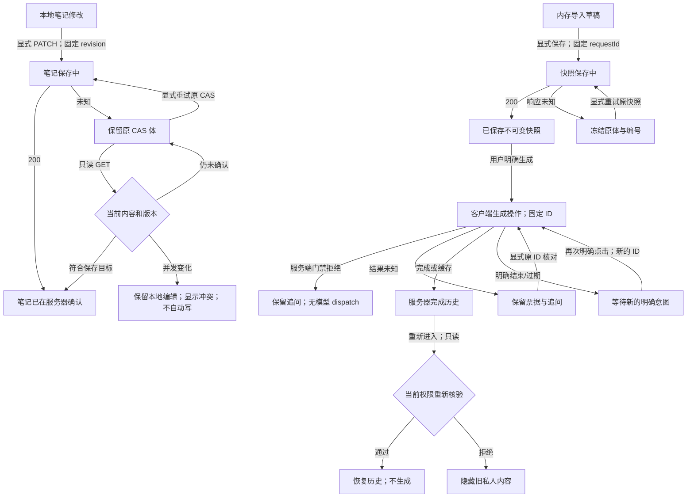

# M3.5 后续：Review 原生导航与复盘草稿连续性验收

日期：2026-10-30，Asia/Shanghai。沿既定工作台/历史/草稿可靠性目标及 [核心可用性报告](M35_CORE_USABILITY_VERIFICATION.md) 的P1后续项；不扩大为路由架构重构，不进入真实模型或真人研究。

## 1. 实际 Git 与工程基线

实际 HEAD **`91e5da77273bd1b0380ed478abff4be9d475bd5e`**，初始工作区干净。上一轮 `c9ea443b…` 的6修改/3新增已由用户提交，不能继续当作当前未提交内容。没有reset/clean、覆盖既有未提交文件、commit/push/PR。

已核查 README、DEVELOPMENT_PLAN v3.4、AGENTS、MILESTONES、M35_CORE_USABILITY、M35_NAVIGATION_DRAFT、M353_REVIEW_RETRY，以及 Review 页面/组件、Repository、API、005/006/011原接口与相关测试。文档确实存在；历史验收原文保留。仅改Review客户端、现有共享导航的通用文案、测试接线及文档；不改服务端、Review Schema、Provider参数/重试、历史迁移、推荐/研究或依赖。

## 2. 实际状态与持久化

| 内容/操作 | 实际持久化及恢复规则 |
| --- | --- |
| 导入代码、URL、题面、提交号、文件来源、选题/关联、确认选项 | 未提交前仅组件内存；完整导入字段与最后确认基线比较，不再只检查code |
| 已保存快照 | `code_reviews`不可变快照及授权记录，requestId对应创建幂等；URL只含原有reviewId，不存私人正文 |
| 快照保存 UNKNOWN | 本页冻结输入、原完整请求体（含problemId）与原编号；仅明确“重试原快照保存”才重发，不自动生成 |
| 用户编辑笔记 | 原 `edit_code_review(id,revision,notes)` CAS；**该接口没有requestId**，本轮不虚构编号或增加迁移 |
| 笔记保存 UNKNOWN | 冻结reviewId/revision/notes；可只读核对，也可明确重试同一CAS体；并发变化不静默覆盖 |
| 未发送追问 | 仅页面内存，不写正式生成历史；发送失败/过期保留原文 |
| 生成pending/UNKNOWN | 沿原reviewId/requestId/question显式查询或重试；不自动重发，不修改Provider重试策略 |
| 过期/已失败生成 | 原编号结束，新的生成必须再点一次；生产默认拒绝仍独立执行 |
| 已完成分析 | 原请求/历史经GET恢复；读取发现对应已完成ID可结算本页票据，不创建生成POST |
| 正在重新核验/权限失败 | 暂不展示旧服务器快照和分析；401/权限403/404清除列表并隐藏导入区，本地编辑内存保留，正确归属重新核验后才显示 |

快照创建、笔记编辑、生成是三种不同操作。离开不取消已提交数据库操作；重新进入不表示允许生成。笔记GET核对只能确认服务器当前内容/版本是否符合目标，不能从相同文本证明恰好是某个丢响应PATCH提交。

## 3. 真实复现与证据

修改生产代码前，在HEAD组件上安装新spec和测试接线，运行 `npm run test:e2e -- review-navigation.spec.ts`：**0 PASS/10 FAIL**，桌面/移动各5。日志 `/private/tmp/algopilot-review-navigation-repro.log`，副本 `/private/tmp/algopilot-gate-e2e-T9DWRo/workspace`，trace/error-context在其 `test-results/`。

| 缺陷 | 实际复现 | 预期/影响 |
| --- | --- | --- |
| 原生后退绕过草稿保护 | 笔记、代码或仅题面输入后调用真实Chromium navigation.back，实际committed而非cancelled | 应提示且可取消，避免未保存内容直接离开 |
| 卸载后创建继续执行 | 阻塞已成功创建的ACK，后退离开后释放；旧create继续open/读取并尝试同步URL，返回页未正确恢复 | 已提交写可完成；旧组件不得再发详情读取或改当前页URL |
| 权限重新读取失败仍显示旧内容 | 已打开快照，再读取收到401，旧笔记/代码仍在DOM | 应隐藏未经当前请求核验的服务器内容，提供明确只读恢复 |

组件预复现另为 **7 FAIL/1 PASS**（新8项）；与旧专项合计212 PASS/7 FAIL。证明补充题面漏判、无原生监听、卸载后多一次详情请求、UNKNOWN快照/笔记无专用核对入口，以及同步重复笔记写。日志 `/private/tmp/algopilot-review-navigation-unit-repro.log`。不以模拟事件替代浏览器结论。

首轮修复后真实浏览器2 PASS/8 FAIL：取消保护及拒绝隐藏已生效，但前进到 `/reviews?reviewId=…` 后无选中快照。trace显示URL有ID、页面却只有列表：原生历史恢复了浅层URL，服务器page props仍为空。新增校验当前client query ID的只读恢复，原10项随后 **10/10 PASS**；这是真实历史恢复缺口，不是提高等待预算。

## 4. 最小实现与行为变化

- 复用 `installNavigationGuard`，只将原Tutor专属确认文案改为通用文案；不合并两个工作台的业务状态、不移动路由。读取最新导入基线、笔记、追问、pending票据和同步操作锁；取消恢复焦点，确认继续原目标。
- 原生同文档traverse在提交历史位置前取消；Link在Next处理前确认，并兼容原预检；刷新/关闭/跨文档仍用beforeunload。无pushState哨兵、无popstate后跳回、无历史循环。
- Review当前query使用既有UUID验证，浅层前进和重新进入只读当前ID；内部明确打开历史仍只replace当前URL，不增加陷阱条目。内部URL同步标记避免自身触发重复详情读取。
- lifecycle、最新读取序号及页面失效计数拦截迟到结果；旧create不能继续GET/open/改URL，旧PATCH不能覆盖新选择。同步锁收敛保存/生成连点，监听器与pageshow监听在卸载清理，StrictMode可重装。
- UNKNOWN创建保留完整不可变请求体及原编号；UNKNOWN笔记提供GET核对和同体CAS重试。快照/笔记读取写入用15秒有界传输，超时进入UNKNOWN、不新编号；没有延长测试或模型调用预算。
- 401/权限403/404触发本页失效，旧内容隐藏；本页换所有者（包括不同记录ID）、交叉review_id结果被拒绝。门禁403属于生成拒绝，不被误当登录撤权，不抹掉可见草稿和历史。

本页失效计数是客户端生命周期隔离，**不是新的数据库/JWT权限revision**。Review原接口依赖每次getUser、归属/RLS与笔记revision，并没有独立的授权revision可供客户端证明。只保证在观察到拒绝、恢复或重新核验时按此规则处理；不承诺浏览器静止期间即时发现远端撤权，也不声称真实Supabase撤权时序已通过。

页面成功核验首条记录后绑定其所有者；另一身份不能沿用这份页面内存中的旧代码/笔记，需在正确身份/有效记录上核验或重新进入新文档。不同身份之间不提供草稿恢复，也不把原身份的草稿带入新账号。

## 5. UNKNOWN、并发和历史保护

快照创建用已有SQL幂等，不更改005/006。重试冻结原requestId、代码和关联，避免输入变化引出新编号；只有明确失败后新的操作才形成新意图。保存快照不会调用模型；缓存恢复也不是新的模型授权。

笔记CAS没有幂等requestId，采用原revision/原文本：GET发现目标文本且版本推进则结算；未确认则保持冻结，显式同体重试可能成功或409；并发版本变化时保留本地文本，显示冲突，读取新revision后也须用户明确保存。不会将GET“尚未观察到提交”当作绝对未提交，不自动PATCH。

生成仍遵循M353：TUTOR_BUSY原编号等待；REVIEW_REQUEST_FAILED结束票据，下一次明确点击才新编号；已完成结果经GET或原编号缓存恢复不重复历史。进入/返回页面不自动发生成POST。历史分析、代码快照与用户编辑分开，用户输入新的代码不会原地改旧快照。

权限失效后的代码/笔记/追问只在当前组件内存保留，服务器内容在核验前不显示；重新核验必须符合原ID/归属。没有localStorage/sessionStorage/IndexedDB、私人URL正文、日志/分析事件或新增远端草稿表。确认刷新后未保存输入会丢失；已保存记录可恢复。未知票据跨文档丢失后不能承诺客户端exactly-once，必须按服务器历史核对，不能自动重发生成。

## 6. 验收矩阵

| 要求 | 实际用例/边界 |
| --- | --- |
| 无修改/已保存正常后退 | 笔记GET核对后干净back/forward，无重复写；成功快照的保留字段不永久dirty |
| 笔记/代码/题面/追问 | 浏览器取消保留、焦点与选择不变；URL/提交号及无关重渲染另有单测 |
| 确认离开 | 原back到dashboard，forward回同ID，history.length不变；新内链只确认一次 |
| 真实前进 | 训练→后退Review→输入追问→forward取消；不是Link替代遍历 |
| 保存失败/UNKNOWN | 已提交快照丢ACK→原体原ID重试→仅1新记录；笔记丢ACK→GET核对→无额外PATCH |
| 保存和导航竞争 | 阻塞真实ACK、取消后确认离开、释放响应、再前进；无旧组件后续GET/POST或URL覆盖 |
| pending/过期 | 双击只1POST；503 UNKNOWN、有效租约409沿原体、过期409结束，新的点击才新编号且仍被生产门禁拒绝 |
| 完成历史/训练往返 | 仅私有3102合成完成夹具，3103只读恢复；返回时403隐藏历史，再核验成功才显示；浏览器生成POST=0 |
| 迟到响应/归属 | 旧PATCH/GET晚到不覆盖当前记录/拒绝状态；不同owner拒绝；本地草稿核验后按原scope恢复 |
| 组件卸载/StrictMode | 移除监听、重新装一次、保存仍可用；旧create不再发新读取；超时释放loading为UNKNOWN |
| 刷新/关闭/直接URL | 真实beforeunload取消保留；确认刷新只有已存笔记恢复，未发追问为空；真实标签关闭 |
| 训练工作台不回归 | 保留原20项导航E2E、Tutor/工作台单元及整条训练/推荐/成长回归 |

新增单元21项（策略、生命周期、CAS/UNKNOWN、权限/归属、浅层URL、StrictMode与超时），新浏览器12场景×桌面/移动=24项。原Review组件11项、SQL恢复10项及Tutor/Review门禁/恢复测试继续执行；SQL使用PGlite，不冒称原生多连接。

## 7. 实际命令与结果

采用原私有副本、排除.env、空HOME、白名单环境、Node离线预载。浏览器另用macOS loopback-only sandbox-exec、禁service worker/外部页面路由、原workers=2/retries=0/30秒与5秒断言预算。

| 命令 | 最终结果 |
| --- | --- |
| npm run lint | PASS，0警告 |
| npm run typecheck | PASS，0类型错误 |
| npm run test -- tests/unit/review-navigation.test.tsx tests/unit/review-workspace.test.tsx tests/integration/review-database.test.ts tests/unit/recommendation-continuity.test.tsx tests/unit/draft-queue.test.ts tests/unit/navigation-guard.test.ts tests/unit/tutor-draft.test.tsx tests/unit/workspace-continuity.test.tsx tests/unit/m34-review.test.ts tests/unit/m34-review-cli.test.ts tests/unit/m34-replay.test.ts tests/unit/m34-replay-cli.test.ts tests/unit/offline-audit.test.ts tests/unit/m34-results-validation.test.ts tests/unit/m34-results-pairing.test.ts tests/unit/m34-results-cli.test.ts --maxWorkers=1 | 232 PASS/0 FAIL（Review新增21+原组件11+SQL恢复10=42，其余原190项） |
| npm run test -- --maxWorkers=1 | 805 PASS/0 FAIL，69文件 |
| npm run test:recommendations -- --maxWorkers=1 | 36 PASS/0 FAIL，8文件 |
| npm run build（含postbuild） | PASS，0构建错误 |
| npm run test:e2e | 118 PASS/0 FAIL，约1.2分钟；原94项及新增24项全部保留 |
| git diff --check | PASS，0空白错误 |

开发记录保留：初版lint因cleanup读取递增ref出现1警告，改为lifecycle epoch隔离，不关规则；typecheck/219专项通过。随后lint/typecheck/231专项通过。浏览器原10项修复后通过；扩展24项先22 PASS/2 FAIL，原因是新增计数器把正常dashboard推荐POST也算成Review请求，已把断言对象收敛为Review接口，保留“无新Review POST”断言及原超时。未据此改变产品或删除断言。

日志 `/private/tmp/algopilot-review-navigation-target.log`、`/private/tmp/algopilot-review-navigation-target-2.log`、`/private/tmp/algopilot-review-navigation-browser-target.log`、`/private/tmp/algopilot-review-navigation-browser-target-2.log`、`/private/tmp/algopilot-review-navigation-browser-expanded.log` 保留各阶段结果。临时目录可能被系统清理，本报告保留稳定定义和结论。

第一版完整静态/231专项/804全量/36推荐/build均通过，日志 `/private/tmp/algopilot-review-navigation-acceptance.log`。随后新增不同ID换所有者场景，实际复现1 FAIL/231 PASS（`/private/tmp/algopilot-review-owner-repro.log`）：仅对同ID检查owner不足以保护旧导入草稿。将同一页面已确认的owner约束应用到所有记录，再运行最终全套；不拿之前804通过替代新增边界的验收。

最终静态/专项/全量/推荐/build日志 `/private/tmp/algopilot-review-continuity-final.log`；副本 `/var/folders/tw/b3ckg3250kd_tv1mh95l05740000gn/T/algopilot-replay-checks-qXgxyI/workspace`，同级 `checks.json` 六个命令exitCode均0。全量约110.6秒、推荐约78.6秒，仍包含原M3.4真实冷却重放；沿用之前的单worker检查命令，没有改原测试预算。

最终完整E2E日志 `/private/tmp/algopilot-review-continuity-browser-final.log`；副本 `/private/tmp/algopilot-gate-e2e-R3yfeP/workspace`，收尾 `/private/tmp/algopilot-gate-e2e-R3yfeP/e2e-audits-tCDHhz/checks.json`，buildExitCode=0、exitCode=0。实际118项全部通过，包含修正计数范围后的两个竞态场景；不是用此前22/24代替完整验收。真实Provider仍未执行。

已查看 `/private/tmp/algopilot-review-navigation-m2-desktop.png` 与 `/private/tmp/algopilot-review-navigation-m2-mobile.png`，取消后笔记与焦点仍保留，说明和保存入口可读。移动页面较长，保持既有布局，没有据截图推断真人满意度或引入无关重排。

278份功能源码/脚本/测试/配置与最终静态副本逐字节相同；E2E仅有既有16份spec离线路由导入和私有Provider预期改写，无意外差异。核对记录 `/private/tmp/algopilot-review-source-checks.json`。最后只收尾文档，未改变已验证功能文件。

## 8. 时间停顿与浏览器边界

旧报告64 PASS/4 FAIL、约463秒共同断层、原配置重跑通过仍保留；根因UNKNOWN。本轮若失败，保留具体测试与trace，未把任何未知停顿归因于休眠、浏览器或应用。现有M3.4重放中的真实3秒槽/30秒冷却另记为已知等待，不调限流或扩大预算。

本轮最终浏览器约1.2分钟完成，未再次观察到旧463秒断层；这不解释旧根因。初始失败、开发前进恢复失败、错误计数及owner边界失败均有可定位的断言/trace/日志，不归因于未知环境问题。未为取得PASS跳过测试、降低旧断言或提高超时。

本轮只验证现有Chromium桌面1440×1000与Pixel7仿真，非实体手机。真实back/forward通过Navigation API及page.goBack/goForward执行，未伪造popstate、pushState或无限历史。beforeunload是否显示、文案和用户激活限制由浏览器控制；OS强杀/崩溃不能保证警告。

Safari/WebKit/Firefox及硬件鼠标/触控板手势 **NOT_RUN**。pageshow persisted处理只做事件单测；真正跨文档BFCache恢复专项NOT_RUN。其他代码绕过预检直接router.push/replace的任意程序导航不承诺可拦截，不通过阻断Next已提交的历史写入伪造回滚。离开确认不授权发送代码或生成。

## 9. 文件与兼容性

修改7个：`src/components/reviews/review-workspace.tsx`、`src/features/sessions/navigation-guard.ts`、`playwright.config.ts`、`scripts/check-offline.mjs`、`scripts/test-offline-e2e.mjs`、`README.md`、`docs/MILESTONES.md`。

新增3个：`tests/unit/review-navigation.test.tsx`、`tests/e2e/review-navigation.spec.ts`、本报告。最终10文件，全部未提交。

未改server/API、Review Schema、数据库/迁移/RLS、Provider/重试/模型、免费门禁、B3、推荐权重与保存目标、M3.4冻结定义、依赖/锁文件。共享导航只通用化确认文案，训练与Review状态仍各自管理，没有新框架或路由重构。

## 10. 安全及外部访问审计

只使用合成身份、代码、题面和既有离线元数据。3103保持源生产拒绝工厂；3102只在已有私有E2E副本接线，单个完成历史测试明确用本机Fixture预置结果，其通过不证明真实模型可用/免费或远端只执行一次。没有改源门禁或加入生产可配置放行机制。

没有主动执行真实模型、付费API、真实Key读取、B4、生产数据库、托管迁移/部署、私人材料外发或真实评审。Node正常批次受预载保护，浏览器受OS沙箱和页面路由保护；每份启动/结束由collector核对，缺失/未发布仍FAIL/UNKNOWN，故障注入目录独立，不回填计数。

| 指标 | 完整收尾的受监控正常范围 | 整轮/未监控范围 |
| --- | --- | --- |
| 外部HTTP、真实DNS、真实Key读取 | 各0；下列逐批记录完整 | 原生后台/未插桩准备与历史缺失累计UNKNOWN |
| 真实模型、付费API、生产数据库 | 无主动操作；受控应用外部路径0 | 未独立分项计量累计UNKNOWN，不宣称远端账单/资格/权限已核验 |
| 私人数据外发 | 无主动外发；测试仅合成、本地传输 | 未监控原生后台累计UNKNOWN |

| 批次 | Node启动/结束 | browser启动/结束 | 页面loopback允许/拒绝 | 功能与审计分别记录 |
| --- | --- | --- | --- | --- |
| HEAD浏览器复现 | 53/53 | 10/10 | 410/0 | 功能10 FAIL；审计PASS |
| 初始组件专项复现 | 43/43 | 不适用 | 不适用 | 功能7 FAIL/212 PASS；审计PASS |
| 不同ID换owner复现 | 43/43 | 不适用 | 不适用 | 功能1 FAIL/231 PASS；审计PASS |
| 扩展浏览器开发批次 | 47/47 | 4/4 | 1097/0 | 功能2 FAIL/22 PASS；审计PASS |
| 最终静态/专项/全量/推荐/build | 184/184 | 不适用 | 不适用 | 功能及审计PASS |
| 最终完整E2E | 55/55 | 12/12 | 8612/0 | 功能及审计PASS |

上述已收尾正常批次issues=[]，六项受监控计数（networkBlocked、dnsBlocked、credentialReadBlocked、externalHTTP、realDNS、realCredentialReads）均0。功能失败不覆盖审计完整性，也不因审计PASS把功能失败改写为成功。不把未监控原生浏览器HTTP/DNS、历史缺失或故障注入计为零；未取得远端账单或真实免费资格证明。

## 11. 结论与剩余事项

- **PASS**：本地21项新边界、原Review/Tutor恢复、232专项、805全量、36推荐、lint/typecheck/build、118完整桌面/移动Chromium E2E、源文件一致性、正常批次审计及diff检查。
- **FAIL历史**：原HEAD浏览器10失败、初始组件7失败、开发前进恢复8失败、计数范围2失败、不同ID换owner1失败及早期lint警告均保留；最终0失败。
- **BLOCKED**：真实免费资格与依赖当前授权/专用环境的真实服务验收。
- **NOT_RUN/未实现**：Safari/硬件/跨文档BFCache、原生与托管数据库、真实模型与真人效果；跨刷新私人草稿/票据持久恢复未实现。

必须分开：本地逻辑正确、Chromium指定导航通过、本页草稿取消时保留、跨刷新持久恢复、服务端历史可恢复；前三项不能证明第四项，第四项本轮未实现。服务器记录恢复也不代表未知的本页票据或未保存文字可找回。历史服务端恢复通过本地合成HTTP契约/SQL回归验证，不冒称托管真实JWT/RLS已验收。

最终HEAD仍为本页开头值；7修改/3新增，共10文件，全部保留未提交供人工审核。本轮无部署、迁移或真实研究，不据自动化成功声称真人满意度提高。

原生PostgreSQL20项、B4、011–013托管部署/完整托管验收、真实模型质量/费用、真人满意度/教学收益继续NOT_RUN；真实免费资格BLOCKED。人工0/40、替代0/5、真实参与者0不变。PGlite或Mock不替代原生/托管验收。

## 12. 下一步与停止边界

优先候选：在现有授权内用合成数据复现Review完整列表读取失败后的单记录恢复/列表状态说明，以及历史与未完成保存的定位是否需要减少操作；先取证，不新增重复页面、长期私人缓存或自动生成。跨刷新保存私人草稿需先定义身份边界、期限、清理和隐私策略，不能顺手加入本轮。

真实撤权时序、Safari/实体设备、托管/原生数据库或模型实验分别满足环境和独立授权条件后再验收。完成本轮测试与报告后停止，不自动继续后续开发或部署。
