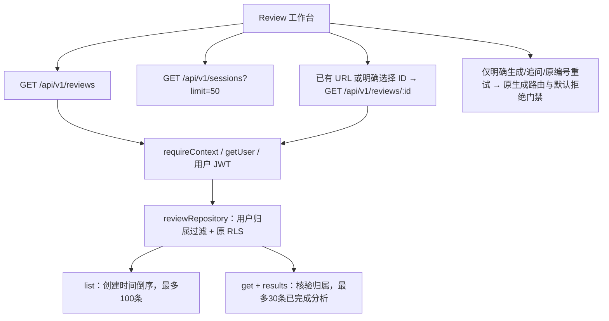

# M3.5 后续：Review 列表失败与单记录恢复验收

日期：2026-10-30，Asia/Shanghai。沿 [Review 连续性报告](M35_REVIEW_CONTINUITY_VERIFICATION.md) 的下一项及 DEVELOPMENT_PLAN.md v3.4 的历史/恢复可靠性目标完成最小切片，不新增 Review 管理功能。

## 1. 实际基线与范围

HEAD **`010cf2c3fa00db3c2d150e1be2273815d3e300b1`**；初始工作区干净。交接 `91e5da7…` 的7修改/3新增已由用户提交，本轮不能继续视为未提交工作。已核查 README、AGENTS、DEVELOPMENT_PLAN、MILESTONES、Review 连续性/导航草稿/重试恢复报告及实际组件、API、Repository、验证结构与测试设施。

只改 Review 客户端、必要离线测试接线及文档；未改 API/Repository、数据库/迁移/RLS、Review Schema、模型工厂/门禁/重试策略、推荐权重/已保存目标、M3.4定义、B3或依赖。无reset/clean、commit/push/PR。最终工作区及验证结果在本文收尾部分记录。

## 2. 原路径与真实缺口

**单记录服务端读取在 HEAD 已独立存在**，本轮未重新开发。列表无分页，仅有倒序limit100；不能将当前列表当完整历史。生成请求、保存快照、笔记CAS及GET是不同操作，读取不创建生成记录。

| 缺口与复现步骤 | HEAD 实际行为及影响 | 修复后 |
| --- | --- | --- |
| Review列表成功、训练选择列表503 | 原Promise.all整体失败，正常Review历史也不呈现 | 两个列表独立状态与显式重试 |
| 初次列表及详情都503，然后显式重取详情成功 | 共享error清除后loaded仍false，出现永久“正在加载复盘…”；列表无独立重试 | 当前详情可用，列表失败单独保留，不再伪装全页加载 |
| 列表返回items字符串等非法契约 | map渲染异常破坏独立详情 | 复用现有Schema安全校验，固定格式错误，不显示原始敏感字段 |
| 详情已核验A，阻塞列表后释放不同owner数据 | 列表可混入另一身份记录 | 在本页已确认owner、失效epoch与生命周期内核对，冲突先隐藏私人内容 |
| 列表确认A，尚未打开详情，保存快照ACK来自B | 代码先被清空，再由后续详情拒绝B | ACK应用前核对owner，拒绝时内存草稿保留；不视为写入回滚 |

生产修改前浏览器4场景×桌面/移动 **0 PASS/8 FAIL**：日志 `/private/tmp/algopilot-review-list-repro.log`，副本 `/tmp/algopilot-gate-e2e-W0Bcoh/workspace`，trace在其test-results。修正过测试定位后，初始12项新组件测试 **3 PASS/9 FAIL**，加原232项共235 PASS/9 FAIL；日志 `/private/tmp/algopilot-review-list-unit-repro-2.log`。更早的unit-repro含测试ID前缀相同及按钮尚未启用的夹具问题，不能全部算产品缺陷。

ACK归属边界的修正夹具复现 **255 PASS/1 FAIL**，日志 `/private/tmp/algopilot-review-list-owner-write-repro-2.log`；在clear草稿前调用同一owner检查后通过。其前一个同名无“-2”开发日志夹具不一致，保留但不作为正式证据。

扩展浏览器测试另复现无效URL选择合法历史后仍显示链接错误：**16 PASS/2 FAIL**，日志 `/private/tmp/algopilot-review-list-browser-expanded.log`，trace目录 `/tmp/algopilot-gate-e2e-4lNJ4K/workspace/test-results`。本地Next源码显示，传回带`__NA`的内部history.state会跳过useSearchParams通知。仅把当前URL的replaceState参数改为null，由App Router复制内部状态并通知；不新增历史条目或更换路由架构。原断言/预算不变，随后18项全部通过。

## 3. 客户端状态与权限边界

| 状态 | 行为 |
| --- | --- |
| list loading/error/ready | 独立于关联训练列表及详情；失败不等于删除，显式只重取列表；上限/排序明确显示 |
| detail reading/verified/failed | 原ID只读重核验，校验返回ID/结果归属与本页owner；核验期间隐藏旧服务端内容；列表成功不替代详情核验 |
| 网络503/列表404/格式错误/超时 | 显示具体列表状态，保留已核验当前记录与本地草稿；列表404不是记录404 |
| 观察到401/权限403/owner冲突 | 增加本页accessEpoch，隐藏旧私人内容/清空可见列表；迟到请求不能重新展示；显式详情核验才可恢复 |
| 详情404 | 不区分不存在与无权限，不泄露另一用户记录；其他自己的列表仍可显式读取，不能据此授权原目标 |
| 无效URL ID | 明确错误，不猜测/遍历ID；可从自己列表明确选择有效记录，无手动枚举入口 |
| 未保存导入/笔记/追问 | 仅当前页内存，保持原导航保护；同记录重读不覆盖新本地编辑或创建新快照 |
| UNKNOWN快照/笔记/生成 | 保留原输入、requestId或CAS revision；列表/详情GET不触发POST/PATCH；仅原有明确操作可重试 |

列表/关联训练校验复用原reviewSchema/sessionSchema，拒绝重复Review ID、非数组或损坏对象，不改Schema。每次列表读取最多15秒传输，组件卸载/epoch变化/任务过期后丢弃迟到响应；同一在途列表或同ID详情快速连点合并。列表读取不占全页保存锁，不把重试变成保存或生成。

选中详情只用本次明确目标及最新读取序号；列表只更新列表，不选择记录、不替换当前详情revision/笔记、不重新发详情GET。独立读出的记录不会伪装为列表已成功返回。已有列表中的对应项可由详情更新，新增快照仍遵循原保存ACK规则。

本页owner来自已通过服务端的响应，用于防止异常跨身份响应污染；服务端每次getUser、用户过滤与RLS保持主权限边界。accessEpoch是**客户端失效计数，不是数据库/JWT授权revision**；保留原笔记CAS和请求幂等。没有新凭据读取、权限绕过或生产配置开关。不承诺空闲页面即时发现远端撤权；真实Supabase身份/撤权时序须另验收。

## 4. 实际操作与测试矩阵

用户持有已有`/reviews?reviewId=合法ID` → 页面独立读取详情和两个列表 → 列表错误只显示“历史列表暂时不可用”及重试 → 详情失败时点“重新核验当前复盘” → 当前记录核验成功可用 → 编辑笔记/代码时重试列表仍保留草稿 → 有新的明确意图才保存或生成。无需重新取全列表、手动输入ID或自动遍历。

新增24项组件测试，9场景×桌面/移动=18项E2E；原测试不删除/跳过。浏览器用真实页面/路由/API与两个合成用户，而非仅调用事件处理器。

| 验收项 | 实际覆盖 |
| --- | --- |
| 列表失败/详情成功；双方失败；列表成功/详情失败 | 独立恢复按钮、分别错误、无永久spinner、只重取目标GET |
| 列表超时/无效响应/重复ID | 真实AbortSignal传输中止单测及浏览器HTTP408；固定错误不泄露原始字段；详情仍可用 |
| 不存在/无权限/登录失效/归属变化 | 双用户浏览器另一人404与自己列表；401单测；不同owner迟到列表及ACK；原服务端SQL/权限回归 |
| 连点/列表和详情同时读取 | 同步任务锁、可控Promise屏障；不重复GET或产生写入 |
| 旧列表晚到/新目标/卸载/权限epoch更新 | 最新ID/本地笔记/代码及CAS revision不覆盖；失效后不复活私人内容；卸载无后续请求 |
| UNKNOWN及原编号重试 | 列表/详情重取不发生成；用户明确重试仍同requestId和问题；不因读取产生新ID |
| 草稿与历史排序 | 同题重读/无关更新保留输入；原后端顺序；空列表不把当前详情误称删除 |
| 原生返回/前进/重新进入 | Chromium page.goBack/goForward实测；列表仍失败时可恢复已存记录，不自动生成；原24项Review及20项训练导航回归继续保留 |

完成历史、pending/过期、笔记/快照UNKNOWN、显式重试及导航取消仍由原Review导航/工作台/数据库回归覆盖。新浏览器UNKNOWN测试只截获合成生成请求返回503以检查客户端票据，不执行真实Provider或证明数据库收到生成。真正PostgreSQL多连接20项仍NOT_RUN。

跨刷新未发送草稿/UNKNOWN票据持久恢复未实现；确认离开后不保证保留。已保存历史经GET恢复与草稿持久化不是同一结论。未写localStorage/sessionStorage/IndexedDB、私人URL正文、日志或外部分析事件。

## 5. 实际验收结果

采用已有`node scripts/check-offline.mjs`：私有副本排除.env、空HOME、白名单环境、Node离线预载，执行以下实际npm命令。`--maxWorkers=1`沿用原验收配置；测试超时及原断言均未放宽。浏览器另用macOS loopback-only网络沙箱，原workers=2、私有副本retries=0、原30秒单例/5秒断言预算；仅3102私有测试副本可接本机Fixture，源工厂及3103维持默认拒绝。

| 命令 | 实际结果 |
| --- | --- |
| npm run lint | PASS，0警告 |
| npm run typecheck | PASS，0类型错误 |
| npm run test -- tests/unit/review-list-recovery.test.tsx tests/unit/review-navigation.test.tsx tests/unit/review-workspace.test.tsx tests/integration/review-database.test.ts tests/unit/recommendation-continuity.test.tsx tests/unit/draft-queue.test.ts tests/unit/navigation-guard.test.ts tests/unit/tutor-draft.test.tsx tests/unit/workspace-continuity.test.tsx tests/unit/m34-review.test.ts tests/unit/m34-review-cli.test.ts tests/unit/m34-replay.test.ts tests/unit/m34-replay-cli.test.ts tests/unit/offline-audit.test.ts tests/unit/m34-results-validation.test.ts tests/unit/m34-results-pairing.test.ts tests/unit/m34-results-cli.test.ts --maxWorkers=1 | 256 PASS/0 FAIL，17文件；新增24，原232保留 |
| npm run test -- --maxWorkers=1 | 829 PASS/0 FAIL，70文件，112.77秒 |
| npm run test:recommendations -- --maxWorkers=1 | 36 PASS/0 FAIL，8文件，77.71秒 |
| npm run build（含postbuild） | PASS，构建及Monaco检查通过 |
| npm run test:e2e -- review-list-recovery.spec.ts | 18 PASS/0 FAIL，桌面9/移动9，7.3秒 |
| npm run test:e2e | 136 PASS/0 FAIL，约1.3分钟；原118项保留 |
| git diff --check | PASS，0空白错误 |

**功能命令通过不等于离线审计通过**。本次完整静态包装脚本的6条npm子命令exitCode均0，但最终包装脚本exitCode=1，原因是审计发现1次被拦截网络尝试，见第7节。更早一次256专项亦有相同类别异常，不能仅引用测试绿色输出宣称整个包装检查PASS。

日志：`/private/tmp/algopilot-review-list-full-checks.log`、`/private/tmp/algopilot-review-list-browser-target-final.log`、`/private/tmp/algopilot-review-list-full-browser.log`。静态checks.json位于`/var/folders/tw/b3ckg3250kd_tv1mh95l05740000gn/T/algopilot-replay-checks-UXVyfe/checks.json`；浏览器checks.json位于`/tmp/algopilot-gate-e2e-J0itVC/e2e-audits-VkUqEy/checks.json`。临时产物可能被系统清理，稳定测试与本文保留定义和结果。

源一致性：按src/tests/scripts/supabase及包/构建/测试配置筛选297文件，静态副本逐字节相同；E2E除既定runtime-provider本机接线与17个spec import改写外相同。验证脚本及汇总保存在`/private/tmp/algopilot-review-list-inspect.mjs`和`/private/tmp/algopilot-review-list-audit-summary.json`，不是生产入口。截图`/private/tmp/algopilot-review-list-m2-desktop.png`与`…-m2-mobile.png`已人工查看，列表错误与当前草稿同时可读，无需新增页面。

旧报告4项失败/约463秒共同停顿和原配置重跑通过仍保留，根因**UNKNOWN**。本轮136项完整E2E未再次观察该长停顿；本轮2项错误是可复现的无效URL查询状态问题，有trace，不将其归咎环境。推荐评测约64秒响应重放保留实际3秒槽/30秒冷却，是已知测试等待，与未知停顿分开。

## 6. 文件及最终工作区

修改6文件：

- `src/components/reviews/review-workspace.tsx`：独立读取/校验/状态/重试、归属隔离、只读恢复、URL通知。
- `playwright.config.ts`：新spec加入既有桌面/移动项目，不改预算。
- `scripts/check-offline.mjs`：原专项追加新组件测试。
- `scripts/test-offline-e2e.mjs`：私有副本包含两份新测试，不改源Provider。
- `README.md`、`docs/MILESTONES.md`：增量入口及停止边界。

新增4文件：`tests/unit/review-list-recovery.test.tsx`、`tests/e2e/review-list-recovery.spec.ts`、本报告、`docs/MVP_RELEASE_GAPS.md`。共10文件，保留未提交。HEAD仍为第1节值。既有历史文件/测试未删除、重置或覆盖；旧保护机制和接口保持，未扩大为通用历史管理或路由重构。

## 7. 安全与审计

只用合成用户/草稿/代码及既有离线公共题库夹具。没有主动执行真实模型/付费API/真实Key读取/B4、生产数据库、托管迁移/部署、私人材料外发或真实研究。列表/详情恢复不触发生成；UNKNOWN专项的合成503仅检验原编号，不代表真正Provider调用。源门禁、B3五文件和历史迁移无改动。

审计收集核对每份启动/结束，缺失或未发布保持UNKNOWN/FAIL，不补写计数。两批静态检查（一次256专项、一次全套）各1次networkBlocked；实际externalHTTP、realDNS、realCredentialReads均0，说明保护器拦截了尝试，不能把“尝试被拒绝”记成“没有尝试”。

| 批次 | Node启动/结束 | browser启动/结束；页面允许/拒绝 | 审计 |
| --- | --- | --- | --- |
| HEAD浏览器复现8失败 | 51/51 | 8/8；431/0 | PASS |
| 早期单元复现/开发6批：unit-repro、unit-repro-2、target、expanded-unit、owner-write-repro、owner-write-repro-2 | 每批44/44 | 不适用 | 均PASS；功能失败与夹具问题分别保留 |
| 第一次256专项final-target | 44/44 | 不适用 | **FAIL：networkBlocked=1** |
| 浏览器初步8通过 | 47/47 | 4/4；437/0 | PASS |
| 扩展浏览器16通过/2失败 | 47/47 | 4/4；1062/0 | PASS |
| 修复URL后18通过 | 47/47 | 4/4；1066/0 | PASS |
| 全套静态/专项/829全量/推荐/build | 186/186 | 不适用 | **FAIL：networkBlocked=1** |
| 完整136项E2E | 55/55 | 12/12；9668/0 | PASS |
| 私有诊断：新增24 / 原专项256 / 全量829 | 3/3、39/39、98/98 | 不适用 | 均PASS，六计数均0 |

两次异常均有完整发布记录，分别为final-target副本audits/`12752-0.json`及全套副本audits/`13343-0.json`。原保护器只记录类别，没有请求目标或调用栈，因此**来源UNKNOWN**；全套对应进程时间为2026-10-29T17:30:27.213Z–17:30:28.268Z。没有依据将其归因于Review、npm、外部模型或设备。

诊断只在`/private/tmp/algopilot-review-list-diagnostic-*`新增私有保护器副本，为拒绝事件记录无参数调用栈，不记URL/正文/env；没有改B3源保护器、计数规则或放行网络。单独24项、原256专项、全829项各实际运行一次，分别1.06/16.54/113.41秒，均0拦截，无调用栈产物；不能据此撤销先前FAIL或宣布来源已修复。实测collector收尾见`/private/tmp/algopilot-review-list-diagnostic-audits.json`，原失败记录保留，不继续无依据重复运行。

13批正常检查及3批诊断都有启动/完成和有效结果，issues=[]；受监控合计networkBlocked=2，dnsBlocked=0、credentialReadBlocked=0、externalHTTP=0、realDNS=0、realCredentialReads=0。本轮未缺失的记录不能代表历史缺失批次也已补齐。

| 安全指标 | 本轮受监控范围 | 整轮/未插桩范围 |
| --- | --- | --- |
| 外部HTTP、真实DNS、真实Key读取 | 各0；2次网络尝试被拒绝，不能记为0次尝试 | 原生浏览器后台、未插桩准备及历史累计 **UNKNOWN** |
| 真实模型请求、付费API、生产数据库 | 无主动操作；受控应用外部路径0；合成本机HTTP不属于真实调用 | 未独立分项计量累计 **UNKNOWN**，不宣称核对了账单/真实资格/生产权限 |
| 私人材料外发 | 无主动外发；新测试仅合成、本机传输 | 未监控后台累计 **UNKNOWN** |

## 8. 分类结论与停止边界

- **PASS（功能）**：独立已知ID恢复、列表重试/格式/超时/权限区分、草稿及CAS/UNKNOWN保护、客户端迟到响应隔离；24新增、256专项、829全量、36推荐、136桌面/移动Chromium、lint/typecheck/build、源一致性及diff检查。
- **FAIL（审计历史，未抹除）**：两批包装脚本因各1次离线拦截返回失败；来源UNKNOWN。后续诊断及浏览器审计PASS不替代这两条FAIL。功能修复前的8浏览器/9组件失败、ACK归属1失败及URL2失败均保留复现证据，最终功能失败0。
- **BLOCKED**：可信真实免费资格及依赖当前明确授权/专用环境的真实服务验收。
- **NOT_RUN**：原生PostgreSQL20项、托管011–013/真实JWT/RLS/多实例、本轮B4及真实模型；Safari/WebKit/Firefox、实体设备/硬件导航/真正跨文档BFCache、真人可用性/教学收益。没有用PGlite、HTTP或Chromium替代。
- **未实现**：私人草稿/本页UNKNOWN票据跨刷新持久恢复；已保存记录的只读恢复仅通过本机合成HTTP契约及SQL回归，不是托管成功证明。

本轮不宣称整体审计全绿或生产可发布；不宣称自动化成功提高真人满意度。真人评审0/40、替代0/5、参与者0不变。

发布前具体优先级见 [MVP_RELEASE_GAPS.md](MVP_RELEASE_GAPS.md)：先补数据安全/持久化的原生与专用托管条件，再满足可信免费资格/独立生成许可，另做客户端与获授权真人验收。本轮后停止，不自动开启新的导航/草稿专项、环境搜索、真实研究、模型请求或部署。全部10文件留未提交供人工审核。
